<p align="center"></p>

Shell and Python glue I used to run several solver processes in parallel against one CTFd instance during the CSAW CTF 2026 qualifiers: a shared board so they don't duplicate work, a CTFd API client, a serialized flag-submission wrapper, and a first-look triage script. The solvers ran side by side, each in its own terminal tab. This repository is the plumbing around them, not the solvers and not any challenge solutions. I wrote up what it was like to play this way, and what it made me doubt about online CTFs, here: https://khalilammar.me/writeups/csaw-four-minutes-thirty-two-seconds

## What is here

```
bin/board         shared state for parallel solvers (append-only JSONL, no server)
bin/ctfd          CTFd v1 API client: list, inspect, bulk-download files, rank, submit
bin/ctfd-env      loads CTFd credentials from ~/.config/ctfd.env without echoing them
bin/submit-flag   the one sanctioned way to submit: serialized, skips solved challenges
bin/triage        60-second first look at a challenge artifact (ELF, pcap, archive, image...)
templates/exploit.py   pwntools skeleton with notes on mistakes that cost time
env.sh            puts bin/ on PATH and sets the board location and solver identity
tests/board_smoke.sh   claim, concurrent-claim, dead-end and resubmit checks (no network)
```

## How it works

There is no scheduler. Coordination is a convention every solver follows through a few commands, plus a human who starts the sessions and says where to focus.

- **Board.** One file, `.board/events.jsonl`. Every write is a single-line JSON append (`claim`, `release`, `note`, `kill`, `flag`) stamped with UTC time and the writer's `$WHO`. `board status` shows solved and open challenges, holders, latest notes and dead ends. `board claim <chal>` runs under `flock`, so two simultaneous claims cannot both succeed (`tests/board_smoke.sh` checks this). `board note` records a finding, `board kill` a ruled-out hypothesis (`board tried <chal>` lists them), and `board flag` a verified flag.
- **Intake and ranking.** `bin/ctfd` is a small `requests` client for the CTFd v1 API. `files` downloads every attachment of every visible challenge in one pass, and `rank` orders challenges by how many points they would lose if more teams solved them first, using CTFd's dynamic-score decay formula. Calls do not follow redirects (a redirect means CTFd bounced you to login), and `submit` makes exactly one attempt, because a rate-limited attempt is already spent.
- **Submission.** `bin/submit-flag <name> <id> <flag>` takes a lock, refuses to resubmit a challenge already marked solved, calls `ctfd submit`, and on success writes the flag to the board. It exists because simultaneous submissions would race for the same slot.
- **Triage.** `bin/triage <file>` prints what changes the next decision: file type, size, hash, entropy, and for ELF files the protections, linkage, language guess (Go, Rust, C++, UPX), risky imports and win-like function names. Other types get the first useful commands (`jadx`, `tshark`, `exiftool`, `binwalk`).

## Quick start

Nothing in this repository contains a token. Credentials come from the environment:

```bash
mkdir -p ~/.config
read -rsp "CTFd token: " T && printf 'CTFD_URL=https://ctf.example.org\nCTFD_TOKEN=%s\n' "$T" > ~/.config/ctfd.env
chmod 600 ~/.config/ctfd.env && unset T

source env.sh                        # in every shell; non-interactive shells skip ~/.bashrc
pip install -r requirements.txt      # triage and the template also use pwntools
board status
bin/ctfd challenges --unsolved
WHO=solver2 board claim some-challenge
submit-flag some-challenge 42 'flag{...}'
```

`CTFD_URL` and `CTFD_TOKEN` are required (or `CTFD_SESSION`, plus `CTFD_CSRF_TOKEN` if needed). `CTF_BOARD_DIR` defaults to `./.board` next to `env.sh`, and `WHO` defaults to `$USER`; give each solver its own. `bin/triage` also calls `file`, `strings`, `binwalk`, `tshark` and `exiftool` when present. `bash tests/board_smoke.sh` checks the board and submit wrapper locally.

## What the board recorded

From the event log of CSAW CTF 2026 quals, 18 to 20 September 2026 (the log is not published because it contains flags and notes for live challenges): 506 events across 40 challenge keys from 23 solver identities, with 45 claims, 23 releases, 423 notes, 14 flag events and a single `kill`. Solvers wrote dead ends into notes far more often than they used `board kill`.

## What it does not do

- It does not start, schedule or stop solvers, choose a challenge for them, or verify a flag other than by the CTFd response.
- Quality of work was not measured. Several solvers sometimes worked the same hard challenge on purpose, and parallelism did not help every challenge: one web challenge stayed open for most of the event because the solvers kept testing the same family of hypotheses.

## Limits and ethics

- Check each event's rules first. Some CTFs restrict automation or API use during the event; I have not assumed any of them allow it. Do not run this against a platform whose rules forbid it.
- `ctfd unlock-hint` spends points. `submit-flag` and `ctfd submit` stop after one attempt on purpose; do not wrap them in a retry loop or use them to guess flags, which most events treat as a rules violation.
- Bulk downloads and polling put load on the organisers' server. Keep requests modest.
- A fast clear is not the same as understanding. After an event I go back and work through what the solvers did.

Not included: per-challenge working directories, handouts, VPN configuration, teammates' notes, challenge-specific solvers and writeups.

## License

MIT, see [LICENSE](LICENSE).
